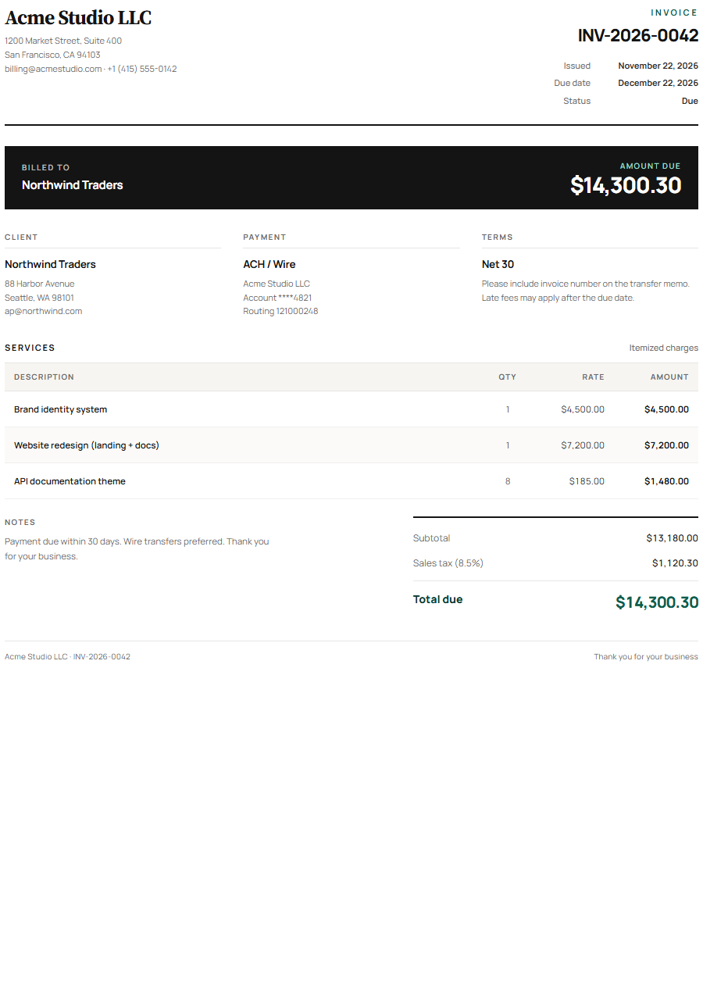
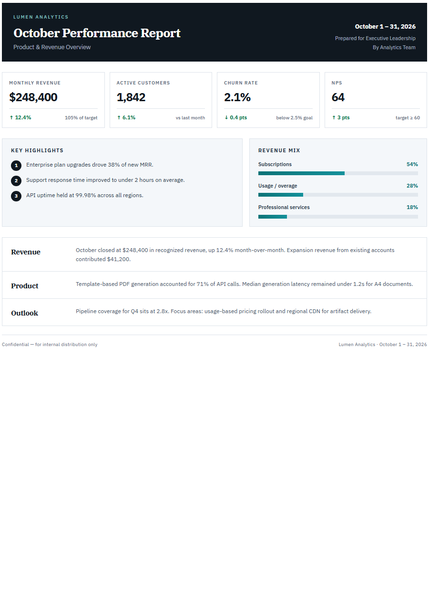
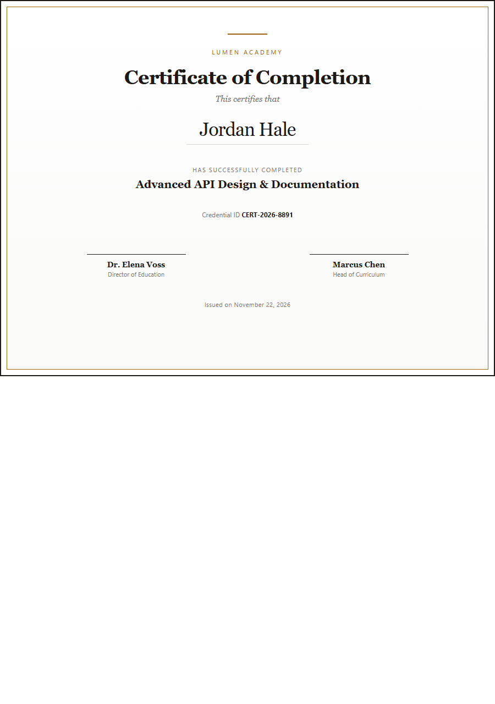

# PDF API

Open-source REST API that turns **HTML + data** into high-quality **PDFs**.

Built for real documents: invoices, reports, certificates, statements, contracts — anything you can style with HTML/CSS.

**Author:** [Jahongir Toshtemirov](https://github.com/Jahongir-Toshtemirov) · Telegram [@itsmejahongir](https://t.me/itsmejahongir)  
**License:** [MIT](./LICENSE)

---

## What this project is

This is a ready-to-run **Node.js backend**:

1. You send HTML (or a template + JSON data) with an API key  
2. The server renders it with **Chromium** (Playwright)  
3. You get a **PDF file** back (or a temporary download link)

It also includes:
- API key authentication + monthly usage limits  
- An **admin panel** to manage keys, templates, and usage  
- Interactive API docs  
- Docker / Railway deployment files  

---

## What you can do with it

| You can… | How |
|----------|-----|
| Generate PDF from raw HTML/CSS | `POST /v1/pdf` |
| Generate PDF from template + JSON data | `POST /v1/pdf/template` |
| Use built-in invoice / report / certificate | `POST /v1/pdf/templates/:id` |
| Return a temporary signed download URL | Set `"delivery": "url"` |
| Control page size, margins, orientation | `options` in the request body |
| List template fields + examples | `GET /v1/templates` |
| Check remaining monthly quota | `GET /v1/usage` |
| Create/revoke API keys | Admin panel `/admin` |
| Edit built-in HTML templates live | Admin → Templates |
| Change default quota / URL expiry | Admin → Settings |

### Built-in templates included

| ID | Use case |
|----|----------|
| `invoice` | Business invoices with line items, tax, totals, payment details |
| `report` | Monthly/executive reports with KPIs and sections |
| `certificate` | Course / award certificates |

You can also send **your own HTML** with full CSS. Chromium renders it, so modern layouts work well.

---

## Tech stack (exact)

| Layer | Technology |
|-------|------------|
| Runtime | **Node.js 20+** |
| Language | **TypeScript** |
| HTTP framework | **Fastify 5** |
| PDF engine | **Playwright (Chromium)** |
| Validation | **Zod** |
| ORM | **Prisma** |
| Auth (API) | API keys (SHA-256 hashed) |
| Auth (Admin) | Email + password (bcrypt) + JWT cookie |
| Docs UI | **Scalar** (OpenAPI 3.1) |
| Logging | **Pino** |
| Containers | **Docker** + docker-compose |
| Deploy target | **Railway** (Dockerfile + `railway.toml`) |

---

## Database support

This project uses **PostgreSQL** through Prisma.

### Works with

| Database / host | Supported? | Notes |
|-----------------|------------|--------|
| **Supabase Postgres** | ✅ Recommended | Use pooler (`DATABASE_URL`) + direct (`DIRECT_URL`) |
| **Railway Postgres** | ✅ | Set both URLs (or same URL for both if no pooler) |
| **Neon / other managed Postgres** | ✅ | Any standard Postgres 14+ |
| **Self-hosted Postgres** | ✅ | Local Docker Postgres or your own server |
| MySQL / MongoDB / SQLite | ❌ | Not supported (schema is Postgres) |

### Required env vars for DB

```env
DATABASE_URL=...   # app connection (pooler OK)
DIRECT_URL=...     # direct connection for Prisma migrations
```

For Supabase: use the **Connection Pooler** URI for `DATABASE_URL` (port `6543`) and the **Session/direct** URI for `DIRECT_URL` (port `5432`).  
URL-encode special characters in passwords (space → `%20`).

---

## Sample outputs

Generated from the built-in templates (what the API actually produces):

| Invoice | Report | Certificate |
|:-------:|:------:|:-----------:|
|  |  |  |

---

## Project features (complete)

### PDF generation
- High CSS fidelity via headless Chromium  
- Mustache-style templates: `{{name}}`, `{{#items}}…{{/items}}`, `{{{rawHtml}}}`  
- Built-in templates + fully custom HTML  
- Options: `format`, `margin`, `landscape`, `scale`, `printBackground`, header/footer templates  
- Delivery: binary PDF **or** signed temporary URL  
- Custom download filenames  

### Security & limits
- Bearer API keys (`pdf_live_...`)  
- Keys hashed at rest (never stored plaintext)  
- Per-key monthly quota (default 100, configurable)  
- Clear JSON errors (`UNAUTHORIZED`, `QUOTA_EXCEEDED`, etc.)  
- Request ID on every response (`x-request-id`)  
- API keys redacted from logs  

### Admin panel (`/admin`)
- Login with email/password  
- Dashboard (total PDFs, active keys, usage this month)  
- Create / edit / revoke / delete API keys  
- Edit invoice/report/certificate HTML in the browser  
- View generation history  
- Update default monthly limit & signed URL TTL  
- Change admin password  

### Developer experience
- Interactive docs at `/docs`  
- OpenAPI spec at `/openapi.json`  
- Health check at `/health`  
- Zod validation on all request bodies  
- Seed script for admin + first API key  

### Deployment
- `Dockerfile` optimized for Playwright/Chromium  
- `docker-compose.yml` for running the API container  
- `railway.toml` for Railway deploys  
- Prisma migrations run on container start  

---

## Requirements before running

1. **Node.js 20+**  
2. **PostgreSQL** (Supabase / Railway / Neon / local)  
3. Disk space for Chromium (~400MB first install)  
4. Copy `.env.example` → `.env` and fill secrets  

### All environment variables

| Variable | Required | Description |
|----------|----------|-------------|
| `DATABASE_URL` | Yes | Postgres connection string for the app |
| `DIRECT_URL` | Yes | Direct Postgres URL for migrations |
| `URL_SIGNING_SECRET` | Yes | Secret for signed PDF download links (16+ chars) |
| `ADMIN_JWT_SECRET` | Recommended | Admin session secret (falls back to `URL_SIGNING_SECRET`) |
| `ADMIN_EMAIL` | Yes (for seed) | Admin login email |
| `ADMIN_PASSWORD` | Yes (for seed) | Admin login password (min 8 chars) |
| `PUBLIC_BASE_URL` | Yes | Public base URL, e.g. `http://localhost:3000` |
| `FREE_TIER_LIMIT` | No | Default monthly PDF limit for new keys (default `100`) |
| `SIGNED_URL_TTL_SECONDS` | No | Signed URL lifetime (default `3600`) |
| `PORT` | No | Server port (default `3000`) |
| `HOST` | No | Bind host (default `0.0.0.0`) |
| `LOG_LEVEL` | No | Pino log level (default `info`) |
| `NODE_ENV` | No | `development` / `production` / `test` |

---

## Quick start

```bash
git clone https://github.com/Jahongir-Toshtemirov/pdf-api.git
cd pdf-api
npm install
npx playwright install chromium

cp .env.example .env
# edit .env with your Postgres URLs + secrets

npx prisma migrate deploy
npm run db:seed
npm run dev
```

After seed, open:

| URL | What |
|-----|------|
| http://localhost:3000/docs | Interactive API docs |
| http://localhost:3000/admin/login | Admin panel |
| http://localhost:3000/health | Health check |

The seed script prints a one-time API key like `pdf_live_...`.

---

## API endpoints

All `/v1/*` routes (except signed downloads) need:

```http
Authorization: Bearer pdf_live_YOUR_KEY
```

| Method | Endpoint | Description |
|--------|----------|-------------|
| `POST` | `/v1/pdf` | Generate PDF from raw HTML |
| `POST` | `/v1/pdf/template` | Generate PDF from HTML template + `data` |
| `POST` | `/v1/pdf/templates/invoice` | Built-in invoice |
| `POST` | `/v1/pdf/templates/report` | Built-in report |
| `POST` | `/v1/pdf/templates/certificate` | Built-in certificate |
| `GET` | `/v1/pdf/download/:id` | Download signed PDF (`?exp=&sig=`) |
| `GET` | `/v1/templates` | List templates + example JSON fields |
| `GET` | `/v1/templates/:id` | One template metadata |
| `GET` | `/v1/usage` | Current month usage for your key |
| `GET` | `/health` | Service + database health |

### Request body options (common)

```json
{
  "options": {
    "format": "A4",
    "margin": { "top": "0.5in", "right": "0.5in", "bottom": "0.5in", "left": "0.5in" },
    "printBackground": true,
    "landscape": false,
    "scale": 1
  },
  "delivery": "binary",
  "filename": "document.pdf"
}
```

- `delivery: "binary"` → response is `application/pdf`  
- `delivery: "url"` → JSON with temporary download link  

---

## Example requests

### 1) Built-in certificate

```bash
curl -X POST http://localhost:3000/v1/pdf/templates/certificate \
  -H "Authorization: Bearer pdf_live_YOUR_KEY" \
  -H "Content-Type: application/json" \
  -d "{
    \"data\": {
      \"title\": \"Certificate of Completion\",
      \"subtitle\": \"This certifies that\",
      \"recipient\": \"Jordan Hale\",
      \"course\": \"Advanced API Design\",
      \"issuedBy\": \"Lumen Academy\",
      \"date\": \"November 22, 2026\",
      \"credentialId\": \"CERT-2026-8891\",
      \"signerName\": \"Dr. Elena Voss\",
      \"signerTitle\": \"Director of Education\",
      \"coSignerName\": \"Marcus Chen\",
      \"coSignerTitle\": \"Head of Curriculum\"
    },
    \"filename\": \"certificate.pdf\"
  }" \
  --output certificate.pdf
```

### 2) Custom template + data

```bash
curl -X POST http://localhost:3000/v1/pdf/template \
  -H "Authorization: Bearer pdf_live_YOUR_KEY" \
  -H "Content-Type: application/json" \
  -d "{
    \"template\": \"<!DOCTYPE html><html><body style='font-family:sans-serif;padding:40px'><h1>{{title}}</h1><p>Hello {{name}}</p></body></html>\",
    \"data\": { \"title\": \"Welcome\", \"name\": \"Jordan\" },
    \"filename\": \"welcome.pdf\"
  }" \
  --output welcome.pdf
```

### 3) Raw HTML

```bash
curl -X POST http://localhost:3000/v1/pdf \
  -H "Authorization: Bearer pdf_live_YOUR_KEY" \
  -H "Content-Type: application/json" \
  -d "{
    \"html\": \"<!DOCTYPE html><html><body><h1>Hello PDF</h1></body></html>\",
    \"options\": { \"format\": \"A4\", \"printBackground\": true }
  }" \
  --output hello.pdf
```

---

## Template syntax

| Syntax | Meaning |
|--------|---------|
| `{{name}}` | Insert escaped value |
| `{{{html}}}` | Insert raw HTML |
| `{{company.name}}` | Nested object path |
| `{{#items}}...{{/items}}` | Loop array / show if truthy |
| `{{^empty}}...{{/empty}}` | Show if falsy / empty |
| `{{.}}` | Current item when looping strings |

---

## Admin panel

1. Run seed  
2. Open http://localhost:3000/admin/login  
3. Login with `ADMIN_EMAIL` / `ADMIN_PASSWORD`  

From the panel you can manage **API keys**, **templates**, **usage**, and **settings**.

If you change admin credentials in `.env`, re-run:

```bash
npm run db:seed
```

---

## Deploy on Railway

1. Create a Railway project from this GitHub repo  
2. Attach Postgres **or** use Supabase and paste URLs into Railway variables  
3. Set all required env vars from the table above  
4. Set `PUBLIC_BASE_URL` to your Railway HTTPS domain  
5. Deploy (migrations run automatically on start)  
6. Seed once: `railway run npm run db:seed`  

Included files: `Dockerfile`, `railway.toml`, `docker-compose.yml`

---

## Local Docker (API only)

Database is still external (Supabase/Postgres). The compose file runs the API container:

```bash
docker compose up --build
```

Make sure `.env` has valid `DATABASE_URL` / `DIRECT_URL`.

---

## Repository structure

```text
src/
  admin/         Admin UI pages
  config/        Environment validation
  lib/           Prisma, Playwright, errors
  middleware/    API key + admin auth
  routes/        REST endpoints
  schemas/       Zod schemas
  services/      Business logic
  templates/     Built-in HTML templates
  utils/         Helpers
docs/examples/   README preview images
prisma/          Schema, migrations, seed
Dockerfile
docker-compose.yml
railway.toml
```

---

## License

MIT — free for personal and commercial use.  
Attribution is optional; mentioning **Jahongir Toshtemirov** is appreciated.

---

## Author

**Jahongir Toshtemirov**

- GitHub: https://github.com/Jahongir-Toshtemirov  
- Telegram: https://t.me/itsmejahongir  
- Repo: https://github.com/Jahongir-Toshtemirov/pdf-api  

Star the repo if it helps you.
